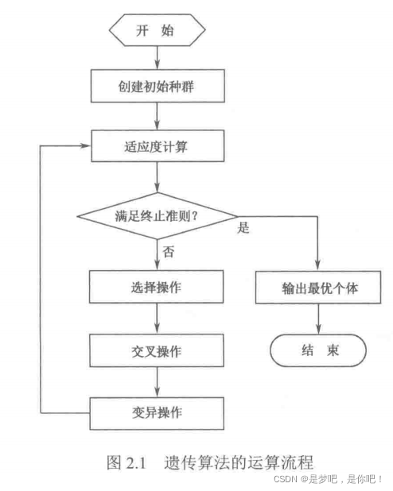

# Generalized Improved Genetic Algorithm for Solving Optimization Problems with Constraints (MATLAB Code)

​  
Contents
1 Introduction
2 Genetic Algorithms
2.1 Basic Concepts of Genetic Algorithms
2.2 Characteristics of Genetic Algorithms
2.3 Program flowchart
3 Python code implementation
3.1 Source code implementation
3.2 The genetic algorithm package sko.GA
3.2.1 Case 1
3.2.2 Case 2
4 References
1 Introduction
Genetic Algorithm (GA) is an adaptive global optimization search algorithm that simulates the genetic and evolutionary processes of organisms in their natural environment. It was first proposed by Professor J.H. Holland in the United States, originating from research on natural and artificial adaptive systems in the 1960s; in the 1970s, K.A. De Jong conducted extensive numerical function optimization computation experiments based on the concept of genetic algorithms; in the 1980s, Genetic Algorithms were summarized and developed by D.J. Goldberg based on a series of research works. Genetic algorithms are random global search and optimization methods developed by mimicking the mechanisms of biological evolution. They draw on Darwin's theory of evolution and Mendel's theory of heredity, essentially being a parallel, efficient, and global search method. It automatically acquires and accumulates knowledge about the search space during the search process and adaptively controls the search process to find the optimal solution. The operation of Genetic Algorithms: Using the principle of "survival of the fittest," iteratively generates an approximate optimal solution within a potential solution population. In each generation, individual selection is performed based on the fitness value of individuals in the problem domain and the recombination method borrowed from natural genetics, producing a new approximate solution. This process leads to the evolution of individuals in the population, resulting in new individuals that are more adapted to the environment than the original ones. The survival of the fittest theory posits that organisms must compete for survival, and to survive, they must engage in struggle with other organisms and the environment. In this struggle, individuals with advantageous mutations are more likely to survive and have more opportunities to pass on these beneficial mutations to their offspring; conversely, those with disadvantageous mutations are more likely to be eliminated, having fewer chances to reproduce. Therefore, individuals who win in the struggle for survival are those with stronger adaptation to the environment. Charles Darwin referred to this process of survival of the fittest as natural selection. Darwin's natural selection theory indicates that genetics and variation are intrinsic factors determining the evolution of life. Genetics refers to the similarity in traits between parents and offspring; variation refers to differences in traits between parents and offspring, as well as among offspring themselves. The relationship between genetics and variation within a living organism is very close. A living organism's genetic characteristics often undergo variation, and some of these variations can be passed on through generations. Genetic transmission ensures the continuity of species characteristics; variation allows organisms to adapt to new environments and continuously advance. All biological activities have a material basis, just as do the genetic and variation phenomena within organisms. According to modern cell biology and genetic studies, the main carriers of genetic material are chromosomes, and genes are segments with genetic effects that store genetic information, can be accurately replicated, and can also mutate. Biological bodies select and control the inheritance of traits through gene replication and crossover, while gene recombination, mutation, and changes in chromosome structure and number produce a variety of variation phenomena. The genetic characteristics of organisms allow species within the biosphere to maintain relative stability; the variation characteristics of organisms lead to the emergence of new traits, thus forming new species, promoting the evolution and development of life. Due to gene crossing and variation in reproduction, continuous slight changes in biological traits occur, providing material conditions and foundation for directed selection by the external environment, making the evolution of life possible.

## Images

<!-- PAYMENT_BLOCK -->

## Get this dataset

- Payment link (Stripe): [Buy now](https://buy.stripe.com/3cs8yP7sY87d0vu9AB)
- Payment QR code: 

<!-- /PAYMENT_BLOCK -->
